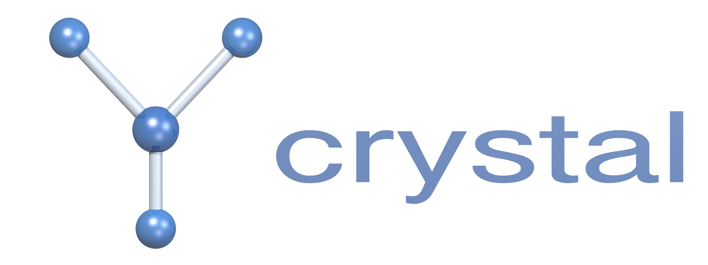

<p align="center">
  
</p>

# Ycrystal

[](LICENSE)
[](docs/guide/appearance.md#choosing-colours)
[](https://github.com/ymatterlab/ycrystal/actions/workflows/ci.yml)
[](CHANGELOG.md)
[](docs/guide/support.md)
[](docs/guide/support.md)
[](https://www.povray.org/)
[](https://github.com/astral-sh/ruff)

Ycrystal prepares reproducible crystal-structure figures and renders them with
[POV-Ray](https://www.povray.org/), on Linux, macOS, and Windows. It has two faces that
share one scene model and one renderer:

- a **desktop application** (PySide6 + VTK) to open a structure, frame it, and design
  its look interactively, with a live view and a POV-Ray preview;
- a **command line** that renders without a window, from a terminal, a script, or a
  remote machine: apply a saved style to any structure, choose the view and scale, and
  render whole series of structures from one JSON manifest, for high-throughput figure
  production.

A look designed in the window can be saved as a style and reused unchanged on the
command line, so figures made by hand and figures made in bulk match.

## Features

- **Structures and projects:** POSCAR/CONTCAR, CIF, and Quantum ESPRESSO
  (`ibrav = 0`) inputs; `.ycrystal` projects that keep the structure, view, and look,
  and reopen without the original files.
- **Interactive view:** orbit, pan, and zoom; free or axis-constrained rotation;
  lattice and Cartesian view directions; select and hide atoms; supercells with
  draggable a/b/c handles, periodic bonds, and cell-edge modes; distance and
  bond-angle measurements; atom-attached direction and magnetic-moment arrows.
- **Appearance:** 30 materials and 12 environments with POV-Ray thumbnails,
  per-element and per-atom materials, editable material recipes, colours by value or
  name, floors, skies, background pictures, and a Lighting Setup window.
- **Output:** a POV-Ray preview, cancellable renders, PNG, PDF, and JPEG export with
  publication sizes, and editable `.pov`/`.ini` scenes. Every figure change is
  undoable.
- **Command line and high-throughput rendering:** `--render` and `--export-pov` for
  single figures; `--style` with explicit `--element-map` between compositions;
  `--view`, `--camera-policy`, and `--view-height` for consistent orientation and
  scale; `--batch` for a series from a JSON manifest, checked completely before
  rendering, with a JSON report of every job. No display is needed.
- **Reproducibility:** self-contained project snapshots with a provenance record, so
  a figure can be rendered again later or elsewhere; a gallery of example figures
  regenerated from scripts.

The Python interface may still change before version 1.0.

## Install and run

Linux Mint 22 / Ubuntu 24.04, system Python 3.12, X11 with OpenGL:

```bash
sudo apt install git povray povray-includes libxcb-cursor0 python3.12-venv
git clone https://github.com/ymatterlab/ycrystal.git
cd ycrystal
/usr/bin/python3 -m venv .venv
.venv/bin/python -m pip install -e . -c constraints.txt
.venv/bin/ycrystal --sample perovskite
```

On Linux use the system interpreter: Conda's bundled `libstdc++` can prevent Mesa from
loading. POV-Ray is needed for rendering PNG, PDF, and JPEG images; viewing and
exporting `.pov`/`.ini` work without it. Check it with `.venv/bin/ycrystal --check-renderer`. While the
repository is private, clone it with `gh repo clone ymatterlab/ycrystal` or over SSH.

macOS 15 on Apple silicon, with [Homebrew](https://brew.sh/):

```bash
brew install python@3.12 povray
git clone https://github.com/ymatterlab/ycrystal.git
cd ycrystal
python3.12 -m venv .venv
.venv/bin/python -m pip install -e . -c constraints.txt
.venv/bin/ycrystal --sample perovskite
```

Windows 11, with Python 3.12 from python.org and POV-Ray for Windows 3.7 from its
official installer, in PowerShell:

```powershell
winget install --id Python.Python.3.12 --exact --scope user   # or python.org's installer
# Then open a NEW PowerShell window (restart VS Code for its terminal), so that py is found.
git clone https://github.com/ymatterlab/ycrystal.git
cd ycrystal
py -3.12 -m venv .venv
.venv\Scripts\python.exe -m pip install -e . -c constraints.txt
.venv\Scripts\ycrystal.exe --sample perovskite
```

`py` is the Python launcher that python.org's installer puts on `PATH`; "py is not
recognized" means Python 3.12 is not installed or the terminal was opened before it
was. Ycrystal finds POV-Ray for Windows in its installation folder; it cannot render while
POV-Ray for Windows is open by hand (see the
[install guide](docs/guide/install.md#windows)). The commands below are written for
Linux and macOS; on Windows, run `.venv\Scripts\ycrystal.exe` and write paths with
backslashes.

```bash
.venv/bin/ycrystal --install-desktop                                    # menu launcher (Linux)
.venv/bin/ycrystal examples/SrTiO3-studio.ycrystal --render SrTiO3.png  # no window
# Reuse a style (studio, lighting, image size) for another structure, without a window:
.venv/bin/ycrystal tests/fixtures/MgB2.cif --style examples/grey-studio.ycstyle --render MgB2.png
# Also give the style's Ti settings (chrome) to Zr, so both perovskites look alike:
.venv/bin/ycrystal tests/fixtures/BaZrO3.cif --style examples/grey-studio.ycstyle --element-map Ti=Zr --render BaZrO3.png
# Look down the c axis, fitted so that nothing is cut off (or --view-height 12 for a fixed scale):
.venv/bin/ycrystal tests/fixtures/MgB2.cif --view c --render MgB2-c.png
# Render a whole series (one style, one view, five structures) from a JSON manifest:
.venv/bin/ycrystal --batch examples/batch-series.json --output-dir renders
# Also save a self-contained snapshot and a provenance record; render the snapshot again later:
.venv/bin/ycrystal tests/fixtures/MgB2.cif --view c --render MgB2-c.png --save-project MgB2-c.ycrystal
.venv/bin/ycrystal MgB2-c.ycrystal --render MgB2-c-again.png
```

Latest release 0.3.0; `main` is the development version 0.4.0.dev0. See the [changelog](CHANGELOG.md), the
[support matrix](docs/guide/support.md), and the [third-party notices](THIRD_PARTY_NOTICES.md).

## Guides and reference

- [Documentation home](docs/index.md), [installation details](docs/guide/install.md), and
  [examples and the command line](docs/guide/examples.md).
- [Your first crystal figure](docs/guide/first-figure.md), [controls](docs/guide/controls.md),
  [supported formats and projects](docs/FORMATS.md), [rendering](docs/guide/rendering.md),
  and [troubleshooting](docs/guide/troubleshooting.md).
- [Developer architecture](docs/development/architecture.md),
  [Python examples](docs/development/examples.md), and [API reference](docs/reference/index.md).
- [Reproducible figures](docs/guide/reproducibility.md) and the
  [figure gallery](docs/guide/gallery.md).
- [Progress and roadmap](docs/PROGRESS.md), [release checklist](docs/development/release.md),
  and [contributing](CONTRIBUTING.md).

Preview and build the source-based reference locally:

```bash
.venv/bin/python -m pip install -e ".[docs]" -c constraints.txt -c docs/requirements.txt
.venv/bin/zensical serve                     # local preview
.venv/bin/zensical build --clean --strict     # HTML in site/ (ignored)
```

The [documentation workflow](docs/development/documentation.md) includes a lightweight
docs-only installation, NumPy-style writing conventions, and asset regeneration.

## Development checks

```bash
.venv/bin/python -m pip install -e ".[dev]" -c constraints.txt
.venv/bin/pre-commit install
.venv/bin/pre-commit run --all-files
.venv/bin/python -m pytest -q -rs
```

On Windows the programs are `.venv\Scripts\python.exe` and `.venv\Scripts\pre-commit.exe`.
GUI tests need a display; renderer tests need POV-Ray. CI runs the full application
suite on Ubuntu under Xvfb with POV-Ray, the tests that need no window on macOS and on
Windows (both with POV-Ray), and builds documentation separately. See
[CONTRIBUTING.md](CONTRIBUTING.md) for strict integration checks and maintenance setup.

## Author

Ycrystal is designed and developed by [@yw-fang](https://github.com/yw-fang)
(Y-Matter Lab).

## License

MIT, see [LICENSE](LICENSE).
