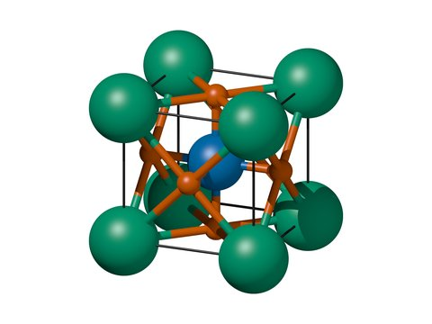
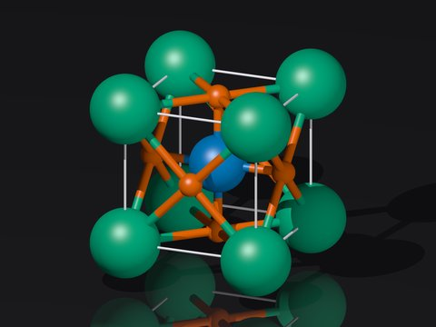
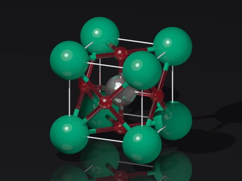
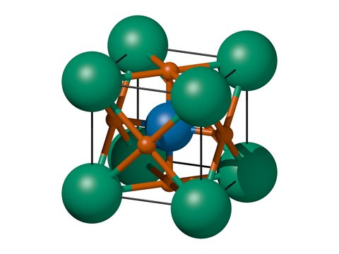
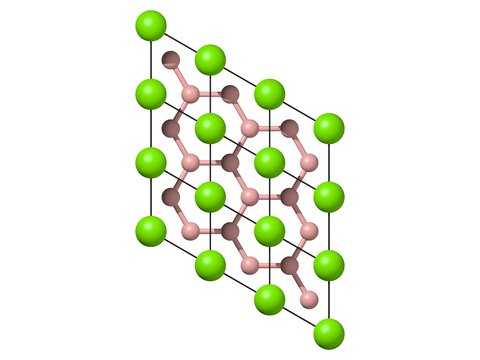
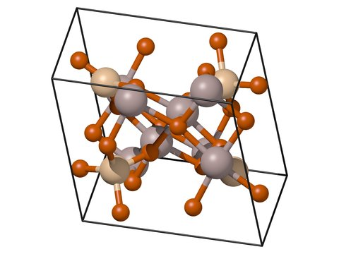
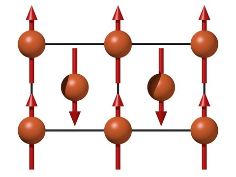

# Figure gallery

Seven figures made by Ycrystal and POV-Ray 3.7 from the inputs in
`examples/publication/`, all by the command line. They show:

- a restrained style for a journal page;
- the same figure with ray-traced lighting and materials;
- one style applied to several compositions with an explicit element mapping;
- a low-symmetry mineral;
- a synthetic magnetic-moment illustration.

The thumbnails below are 480 px wide JPEG copies, downscaled from the 1600 × 1200 PNG
renders of the run recorded at the [end of this page](#figure-methods). They are not
mock-ups.

## Lighting and materials, with geometry and camera fixed

| Paper style | Cover environment only | Cover environment and materials |
| --- | --- | --- |
|  |  |  |

The left image is rendered from `SrTiO3.cif` with `styles/paper.ycstyle`. Its
snapshot `srtio3.ycrystal` is then rendered with `styles/cover.ycstyle`:

- the middle image applies only the cover's environment: a dark studio, a reflective
  floor, and hard shadows;
- the right image also applies its materials: ceramic Sr, chrome Ti, ruby-glass O.

A snapshot keeps its camera and image size, so the structure, camera, and size are
exactly the same in all three; `tests/test_gallery.py` checks this. Reflections and
refraction are computed by POV-Ray. The materials are a presentation choice, not
physical properties of the atoms.

## One style, several structures

| SrTiO3 | BaZrO3, Sr → Ba, Ti → Zr | MgB2 |
| --- | --- | --- |
|  |  |  |

| Kyanite, Al₂SiO₅ (P-1, COD 1008755) | Synthetic antiferromagnet (not a real material) |
| --- | --- |
|  |  |

All five come from one batch manifest, `gallery.json`, with the paper style:

- **SrTiO3 and BaZrO3** share a visible height of 9 Å, so the larger BaZrO3 cell
  (a = 4.19 Å against 3.905 Å) appears larger. BaZrO3 keeps the A and B site colours
  through the explicit mapping `"element_map": {"Sr": "Ba", "Ti": "Zr"}`. The mapping is
  a presentation choice, not chemical equivalence.
- **MgB2** (3 × 3 × 1 cells, looking down c, showing the boron honeycomb) and
  **kyanite** receive the style's background, lighting, size, and default material.
  Their elements keep their default colours, except kyanite's O, which matches the
  style's O. The run prints a warning for each element setting it could not use.
- **The antiferromagnet** is synthetic: moments of ±2.2 μB assigned by hand. It
  illustrates atom-attached vectors, not a real material.

Sources and licences of the structures are listed in `examples/publication/README.md`.

## Make the figures yourself

```bash
python scripts/make_gallery.py --out artifacts/gallery
```

The script copies the inputs to a temporary folder and runs the batch manifest there.
It renders the two cover variants from the SrTiO3 snapshot and then **deletes the
inputs**. Next it renders every snapshot again with `scripts/replay_check.py` and
compares the pixels. Finally it writes the figure-methods table below
(`figure-methods.md`) and the list of commands it ran (`commands.txt`).

- On the development laptop (Linux, POV-Ray 3.7.0.10), the whole run at 1600 × 1200
  took well under a minute of rendering: 9.7 s for the five batch figures, 2.6 s and
  9.2 s for the two variants. All 7 replays had identical pixels.
- `--scale 0.25` makes the same figures at a quarter of the size, for a quick check.
- `--thumbnails docs/assets/gallery` also writes the thumbnails of this page.

To render one figure again from its snapshot, for example on another computer:

```bash
ycrystal artifacts/gallery/figures/kyanite.ycrystal --render kyanite-again.png
```

## SrTiO₃ with coordination polyhedra and figure text

Open `examples/SrTiO3-cover.ycrystal` for a 3 × 3 × 2 cubic perovskite with 18
corner-sharing TiO₆ octahedra and Ti–O bonds. The project includes the background,
camera, and text. **Scene ▸ Polyhedra**, **Bonds**, and **Text** control these
elements of the figure.

```bash
ycrystal examples/SrTiO3-cover.ycrystal --render SrTiO3-cover.png
```

## Figure methods

Written by `scripts/make_gallery.py` from the provenance records and snapshots of the
run on 17 November 2026 (Linux Mint 22.1 laptop, Ycrystal 0.4.0.dev0, POV-Ray
3.7.0.10.unofficial), unedited. *Atoms* counts the atoms of the structure, *displayed*
those drawn (with periodic images and repetitions). The two variants have the snapshot
`srtio3.ycrystal` as their input; *saved* means the snapshot's camera was used as it
is.

| Figure | Input | Atoms (displayed) | Size, px | Style (parts; mapping) | Camera | Key settings | Renderer |
| --- | --- | --- | --- | --- | --- | --- | --- |
| srtio3.png: SrTiO3, paper style | SrTiO3.cif | 5 (15) | 1600 × 1200 | paper.ycstyle (appearance, environment, output) | fit: default, fixed height 9 Å | white background, soft lighting; default material satin; element colours O, Sr, Ti | POV-Ray 3.7.0.10.unofficial |
| srtio3-cover-light.png: SrTiO3, same snapshot: cover environment only | srtio3.ycrystal | 5 (15) | 1600 × 1200 | cover.ycstyle (environment) | saved: saved orientation | studio_dark background, bright lighting; floor (reflection 0.35); default material satin; element colours O, Sr, Ti | POV-Ray 3.7.0.10.unofficial |
| srtio3-cover.png: SrTiO3, same snapshot: cover environment and materials | srtio3.ycrystal | 5 (15) | 1600 × 1200 | cover.ycstyle (appearance, environment) | saved: saved orientation | studio_dark background, bright lighting; floor (reflection 0.35); default material satin; O glass_ruby, Sr ceramic, Ti chrome; element colours O, Sr, Ti | POV-Ray 3.7.0.10.unofficial |
| bazro3-mapped.png: BaZrO3, paper style mapped Sr → Ba, Ti → Zr | BaZrO3.cif | 5 (15) | 1600 × 1200 | paper.ycstyle (appearance, environment, output; Sr → Ba, Ti → Zr) | fit: default, fixed height 9 Å | white background, soft lighting; default material satin; element colours Ba, O, Zr | POV-Ray 3.7.0.10.unofficial |
| mgb2.png: MgB2 3 × 3 × 1 down c, paper style (no settings for Mg, B) | MgB2-gradient.ycrystal | 3 (50) | 1600 × 1200 | paper.ycstyle (appearance, environment, output) | fit: c | white background, soft lighting; default material satin | POV-Ray 3.7.0.10.unofficial |
| kyanite.png: Kyanite Al2SiO5 (COD 1008755), paper style | kyanite-COD-1008755.cif | 32 (34) | 1600 × 1200 | paper.ycstyle (appearance, environment, output) | fit: default | white background, soft lighting; default material satin; element colours O | POV-Ray 3.7.0.10.unofficial |
| afm-synthetic.png: Synthetic antiferromagnet (not a real material), paper style | vectors-synthetic-afm.ycrystal | 2 (22) | 1600 × 1200 | paper.ycstyle (appearance, environment, output) | fit: a | white background, soft lighting; default material satin; 2 source vectors | POV-Ray 3.7.0.10.unofficial |

The scenes need the standard POV-Ray include file `textures.inc` for chrome and ruby
glass. It belongs to the POV-Ray installation and is not part of the inputs.
