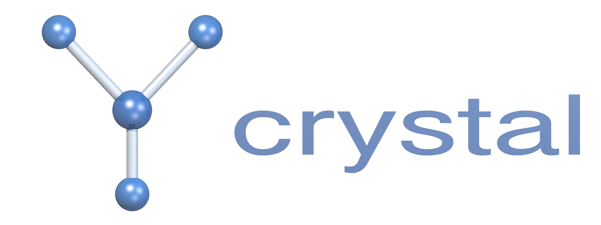
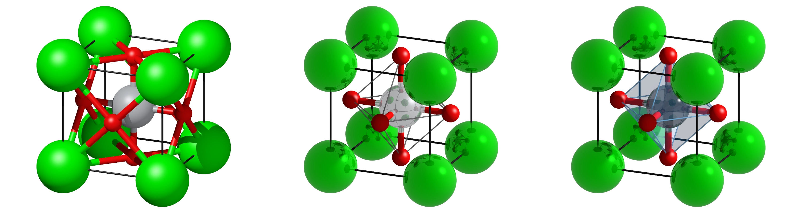

# Ycrystal

{ width="480" }

Ycrystal is a desktop application for Linux, macOS, and Windows for composing crystal-structure
figures and
rendering the current view with [POV-Ray](https://www.povray.org/). The live interface
uses PySide6 and VTK; the exported scene keeps the same orthographic camera and
displayed atoms.

**Early development.** You can open POSCAR/CONTCAR, CIF, and Quantum ESPRESSO
inputs ([any `ibrav`](guide/qe-lattices.md)), save self-contained `.ycrystal` projects,
navigate, select and hide
individual displayed atoms, export scenes, and render PNG, PDF, or JPEG figures. Supercell repetitions,
periodic bonds, cell-edge modes, and view-direction controls
are available, as are an output frame, a POV-Ray preview, cancellable renders, and
galleries of 30 materials and 12 environments with POV-Ray thumbnails, per-element and
per-atom materials, floors, skies, and lighting controls, and an
[element legend](guide/rendering.md#element-legend) for the figure. Drag the a/b/c handles to add
cells, rotate freely or about a lattice/Cartesian axis, and reuse a figure's style with
another structure, in the window or [from the command line](guide/examples.md#apply-a-style-from-the-command-line);
every figure change is undoable.

[Ycrystal 0.5.0](https://github.com/ymatterlab/ycrystal/releases/tag/v0.5.0) includes
the element legend and support for Quantum ESPRESSO `ibrav` other than 0 in both
the Windows installer and tagged source. These pages follow `main`. See the
[release and feature status](HANDOFF.md#current-project-status) for details.

- [Install and launch](guide/install.md) on Linux Mint or macOS.
- Follow [Your first crystal figure](guide/first-figure.md) using the built-in SrTiO3 sample.
- Find [controls](guide/controls.md), [supported formats](FORMATS.md), and
  [rendering instructions](guide/rendering.md); save a figure with a self-contained
  snapshot and a provenance record for [reproducible figures](guide/reproducibility.md).
- Read the [architecture](development/architecture.md), try the
  [Python examples](development/examples.md), or consult the [API reference](reference/index.md).
- See [troubleshooting and limitations](guide/troubleshooting.md) and the
  [progress record and roadmap](PROGRESS.md) for the current scope and evidence.

All three Ycrystal renders share the same camera and show equivalent atoms on the
cell boundary. The left panel shows the default view. The middle panel uses
metallic finishes and side lighting, hides Sr–O bonds, and outlines the TiO₆ octahedron.
The right panel uses glass for Ti and fills the octahedron with translucent blue
faces. [Regenerate the default view](development/documentation.md#visual-assets).

The Python interfaces are evolving developer functionality. They do not currently
carry a stable public API guarantee. This site is built from the repository and
published at [ymatterlab.github.io/ycrystal](https://ymatterlab.github.io/ycrystal/).
